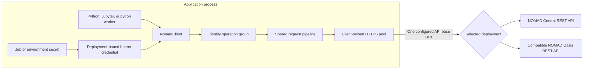

# System architecture

`nomad-python-api` is a Python client for NOMAD Central's REST API. It can connect to a compatible Oasis using an explicit API base URL. A client instance selects one deployment and uses a credential bound to that deployment. Application code can use the same public API in a script, a Jupyter kernel, or a pyiron worker.

## Components and deployment

The client application and the chosen deployment are separate trust boundaries. Only the transport holds HTTPX request and response objects. Public operation results and exceptions use SDK-owned types.

## Package organization

| Location | Responsibility |
| --- | --- |
| `nomad_python_api/_client.py` | Public constructor, feature group properties, and connection-pool lifecycle. |
| `nomad_python_api/identity/` | Bearer credential, identity operations, account model, and public identity exports. |
| `nomad_python_api/_core/` | Deployment URL validation, shared operation records, local scope policy, and HTTP response handling. |
| `nomad_python_api/_scopes.py` and `exceptions.py` | Shared scope names and the exception types callers use across features. |
| `tests/unit/identity/` and `tests/snippets/identity/` | Offline behavior tests and the runnable examples used in the user docs. |

The public client wires feature groups to the shared pipeline. A feature declares its operation and maps a bounded response into an SDK type. The pipeline applies transport and security policy without depending on the feature's response model. An Oasis fork should change a feature's route, request fields, or mapper at that feature boundary when the difference is specific to its deployment.

## Design boundaries

| Area | Rule |
| --- | --- |
| **Local authorization** | The allowed scope set is a client-side limit checked before credentials and HTTP. The deployment authorizes actual token privileges and resource access. |
| **Network** | Bind credentials to the complete API base URL, including the deployment path. Use HTTPS and verified certificates, support explicit private CA trust, and decline redirects. |
| **Performance** | Client construction and local inspection send zero requests. Reuse one bounded HTTP pool per client, and close it when done. The current account call attempts one request. |
| **Process isolation** | Construct clients within the script, kernel, or worker that uses them. Keep bearer tokens out of serialized job inputs, saved notebook output, and source files. |
| **Extension fields** | Add explicit per-operation mappings for a supported query, JSON, or multipart location. Keep destination, authentication, and required scopes under SDK control. |

See [Identity architecture](../identity/index.md) for class relationships, call flow, state, and data. See [Develop for NOMAD Oasis](../oasis/index.md) to onboard a fork.
