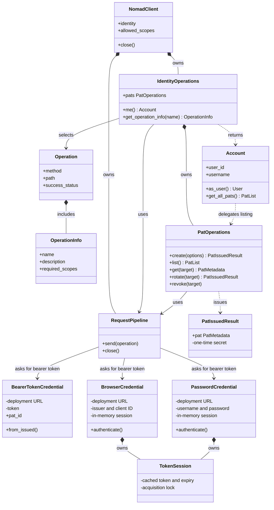
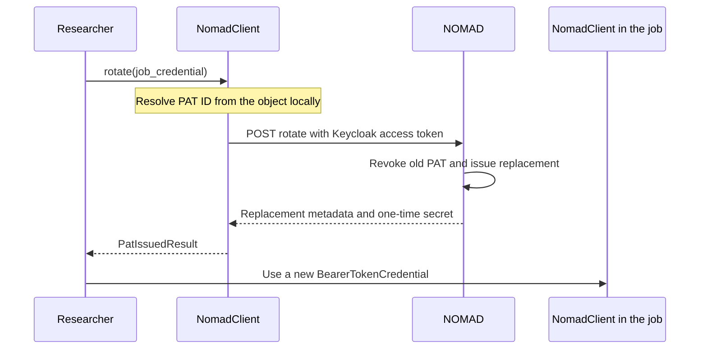
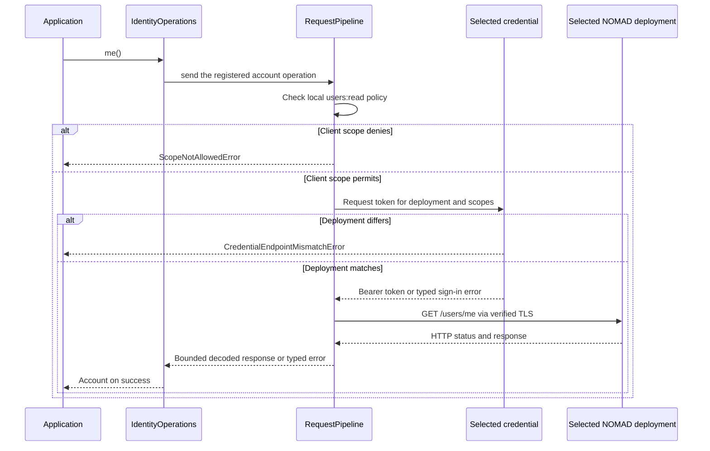
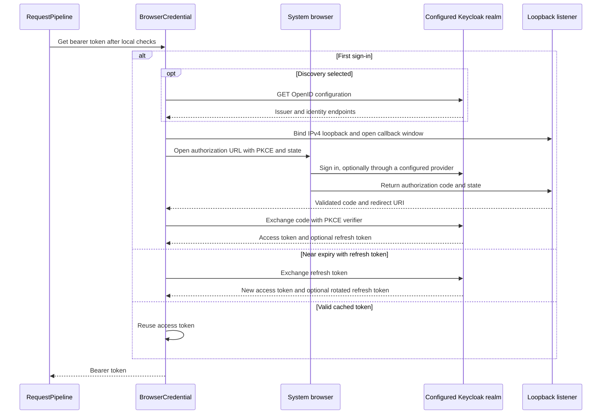
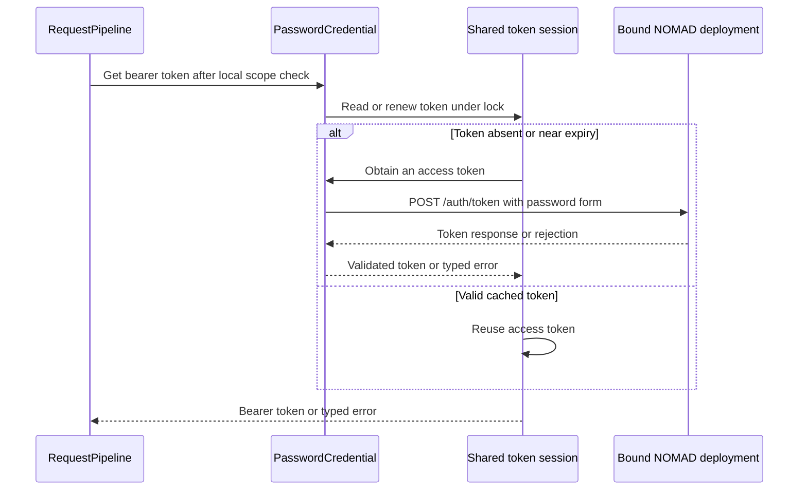
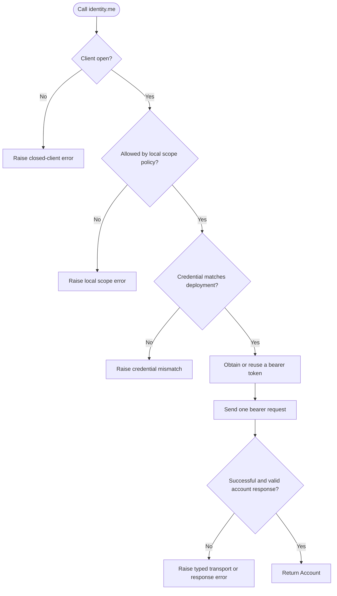
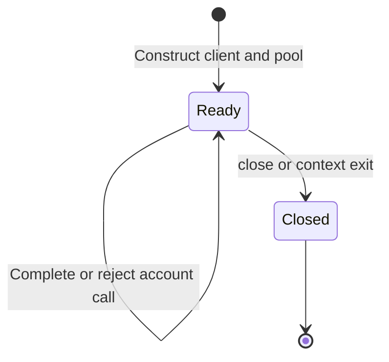
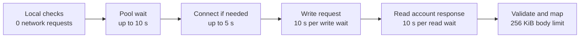
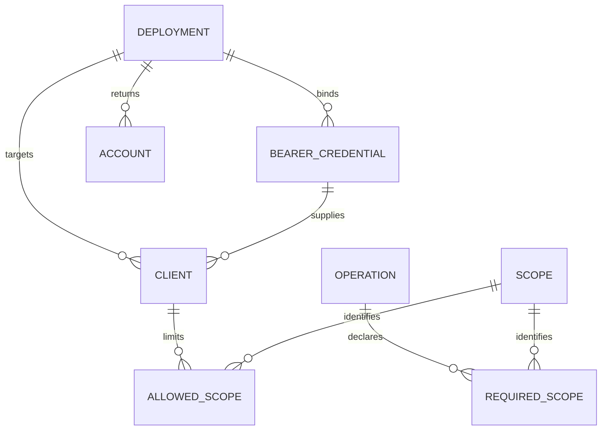

# Identity architecture

`client.identity.me()` calls `GET /users/me` using a bearer token and returns an SDK-owned `Account`. The credential selects the deployment and can supply an existing token or obtain one through browser or password sign-in. The [system architecture](../architecture/index.md) shows how this fits into NOMAD Central and self-hosted NOMAD Oasis. The [production OpenAPI schema](https://nomad-lab.eu/prod/v1/api/v1/openapi.json) defines the account route and response.

## Classes and their responsibilities

The `me` operation declaration in `identity/_operations.py` supplies both the required scope used by the pipeline and the metadata returned by `get_operation_info("me")`. The client initializes the pipeline with the credential's normalized API URL. Each credential still checks deployment binding before supplying a token. `identity/_account.py` holds the public result model.

PAT management is registered in `identity/_pats.py`. The pipeline applies
scope policy before token acquisition and keeps the method, encoded path,
query, and JSON body separate. Each declaration supplies an accepted
status. The shared pipeline handles bounded JSON and empty `204` replies.
The PAT layer handles request, target, and uncertain-write errors.

### PAT rotation sequence

The PAT management call sends the client's access token and the target's
metadata ID. Only the job credential carries the target secret. Write calls
have a single attempt. Rotation can revoke the original and then return
HTTP `400` if replacement creation fails. The SDK treats that response
and unusable issuance results as uncertain outcomes. The caller checks
server state before another attempt.

`Account` holds a weak reference to the originating PAT operations for
`get_all_pats()`. Serialization omits that connection. PAT listing is lazy.
It reapplies the same validated filters and uses only opaque continuation
cursors against the configured deployment. It never follows server-provided
pagination URLs. The [REST reference](../../user/identity/rest.md#pat-rest)
describes the request fields and extension points.

## Request sequence

Construction and inspection are local. A scope denial or deployment mismatch occurs before the first HTTP request. On this feature, server `401`, `403`, and `429` map to different errors. No automatic retry occurs.

## Browser sign-in and refresh

One lock per credential serializes discovery, sign-in, and refresh. The callback accepts only the configured path and loopback host header, validates state, checks `iss` when present, and closes at the end of each sign-in attempt. Discovery and token requests use a short-lived HTTP client with verified TLS and redirects disabled. The SDK bounds their JSON responses to 64 KiB. [Browser-login REST fields](../../user/identity/rest.md#browser-login-rest)

## Password sign-in and renewal

`identity/_token.py` shares token response validation, bounded HTTP exchanges, and concurrent caching between the two sign-in credentials. Password renewal repeats the exchange against the same NOMAD endpoint. A rejected login clears the cached token and blocks automatic exchanges until explicit authentication. [Password-login REST fields](../../user/identity/rest.md#password-login-rest)

## Activity and lifecycle

The state diagram describes the API client lifecycle. The browser and password credentials keep their sessions in memory, and the bearer credential holds its supplied token. Each can be reused in another client on its bound deployment. The default client owns its API pool. A client using an injected transport or HTTPX client leaves the borrowed pool open.

## Timing and resource limits

The API client defaults to 10 connections, 5 idle keep-alive connections, and 5 seconds of idle reuse. The connect timeout defaults to 5 seconds. Pool, read, and write timeouts each default to 10 seconds. Callers can configure each setting. Read and write timeouts measure inactivity within their respective phases, and the connect timeout governs opening a connection. A `PoolTimeoutError` means the data request timed out before sending. The account call requests an uncompressed body so the byte limit can be enforced before JSON parsing. [SDK connection settings](../../user/identity/api.md#connection-limits) · [HTTPX timeout model](https://www.python-httpx.org/advanced/timeouts/)

## Identity and scope data

This is a conceptual entity-relationship diagram for SDK objects and the deployment that validates them.

The SDK does not create a credential database or infer token grants from the token string. The local allowed scopes and operation requirements are separate from the deployment's authorization data. An account response contains only values returned by the deployment and mapped by the SDK.

## Where to customize and verify

To adapt a fork, start with the identity operation declaration and the account mapper. Keep endpoint validation, bearer attachment, scope checks, and response bounds in the shared pipeline. Place offline tests in `tests/unit/identity/` and runnable examples in `tests/snippets/identity/`. Update the identity walkthrough and REST appendix together so the documented route, fields, and scope match the code. Follow the [Oasis onboarding guide](../oasis/index.md) for the fork and release workflow.
