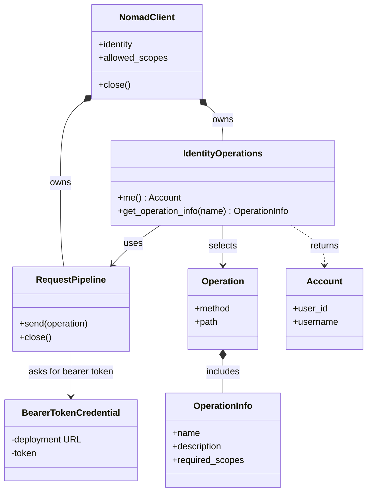
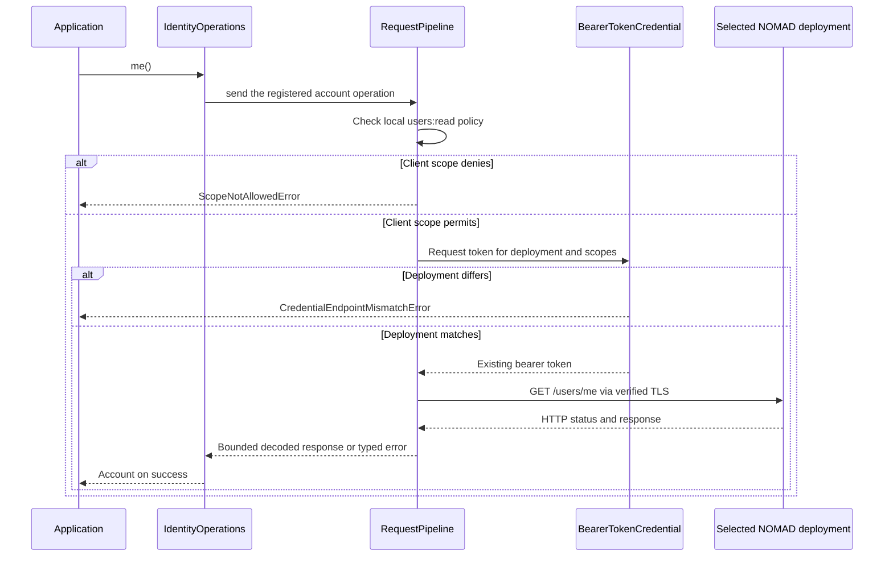
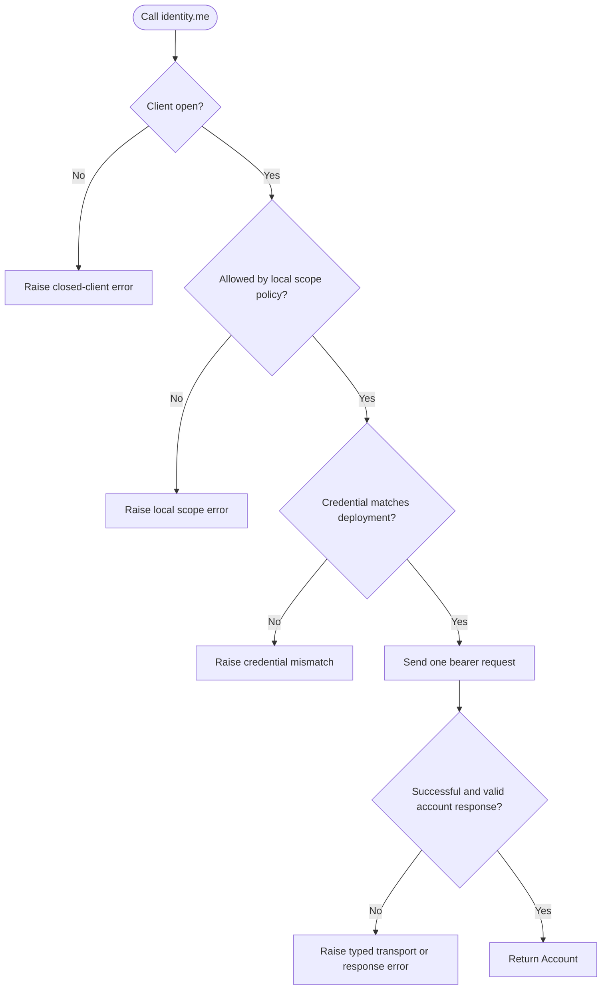
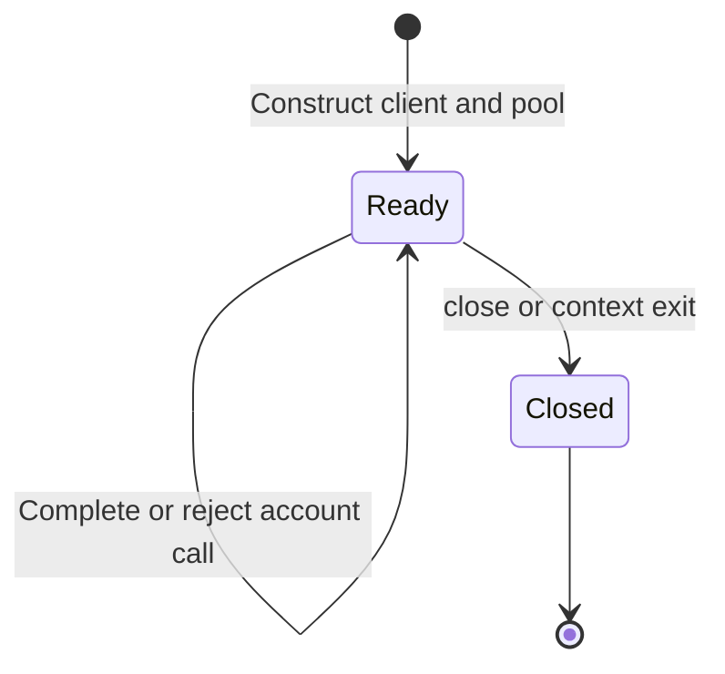
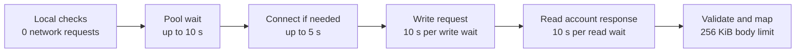
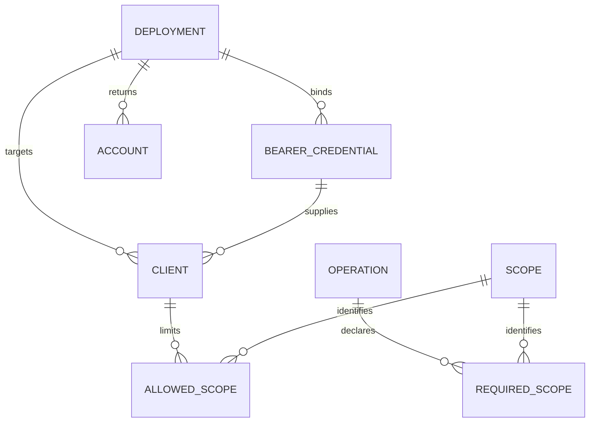

# Identity architecture

`client.identity.me()` calls `GET /users/me` using an existing bearer token and returns an SDK-owned `Account`. This page describes the identity feature and the shared request pipeline it uses. The [system architecture](../architecture/index.md) shows where it fits in a Python or Oasis deployment. The [production OpenAPI schema](https://nomad-lab.eu/prod/v1/api/v1/openapi.json) defines the upstream route and response.

## Classes and their responsibilities

The `me` operation declaration in `identity/_operations.py` supplies both the required scope used by the pipeline and the metadata returned by `get_operation_info("me")`. `identity/_credential.py` checks the credential's deployment binding. `identity/_account.py` holds the public result model.

## Request sequence

Construction and inspection are local. A scope denial or deployment mismatch occurs before the first HTTP request. On this feature, server `401`, `403`, and `429` map to different errors. No automatic retry occurs.

## Activity and lifecycle

The state diagram describes the client lifecycle. The supplied credential holds one opaque token in memory throughout that lifecycle. The caller can reuse the credential in another client for the same deployment. Sockets belong to each client's pool.

## Timing and resource limits

HTTPX timeouts bound individual phases. Read and write timeouts apply to activity within the corresponding phase. They do not add up to a fixed end-to-end deadline. Pool limits are 10 connections and 5 idle keep-alive connections per client. The account call requests an uncompressed body so the byte limit can be enforced before JSON parsing. [HTTPX timeout model](https://www.python-httpx.org/advanced/timeouts/) · [HTTPX pool limits](https://www.python-httpx.org/advanced/resource-limits/)

## Identity and scope data

This is a conceptual entity-relationship diagram for SDK objects and the deployment that validates them.

The SDK does not create a credential database or infer token grants from the token string. The local allowed scopes and operation requirements are separate from the deployment's authorization data. An account response contains only values returned by the deployment and mapped by the SDK.

## Where to customize and verify

To adapt a fork, start with the identity operation declaration and the account mapper. Keep endpoint validation, bearer attachment, scope checks, and response bounds in the shared pipeline. Place offline tests in `tests/unit/identity/` and runnable examples in `tests/snippets/identity/`. Update the identity walkthrough and REST appendix together so the documented route, fields, and scope match the code. Follow the [Oasis onboarding guide](../oasis/index.md) for the fork and release workflow.
