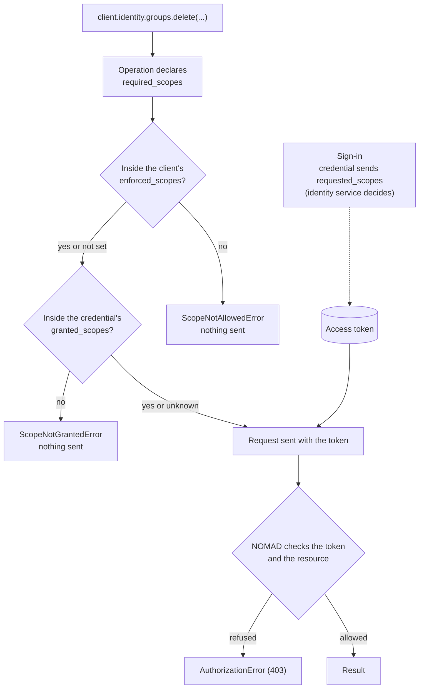

# Access and scopes

A scope names one kind of permission, such as `users:read` or `groups:delete`.
The SDK uses scopes in three distinct places. Only NOMAD makes the final
decision about whether a request is allowed.

| Setting | Where you set it | What it does |
| --- | --- | --- |
| [`enforced_scopes`](#enforced-scopes) | `NomadClient` | A local limit. The client refuses operations outside it before signing in or sending a request. |
| [`requested_scopes`](#requested-scopes) | `PasswordCredential`, `BrowserCredential` | **Advanced.** Scope names sent during sign-in. An OIDC provider processes browser scopes; stock NOMAD 2.x ignores the password form field. Neither setting is a local policy. |
| [`granted_scopes`](#granted-scopes) | Read-only on every credential | The scopes the token is known to carry, or `None` when the SDK cannot know them. |

## How a request is checked { #how-a-request-is-checked }



## Compare the three settings { #compare }

| | `enforced_scopes` | `requested_scopes` | `granted_scopes` |
| --- | --- | --- | --- |
| Set on | `NomadClient(enforced_scopes=...)` | `PasswordCredential(...)`, `BrowserCredential(...)` | Read-only property of the credential |
| Who decides | You, locally | You ask; the identity service decides | NOMAD, when it issued an SDK-created PAT |
| Sent over the network | Never | Yes, as the OAuth `scope` value at sign-in | No |
| Restricts the token | No | Only if the deployment honours it | Describes the token |
| Checked before a request | Yes, raises `ScopeNotAllowedError` | No | Yes when known, raises `ScopeNotGrantedError` |
| Effect on NOMAD Central today | Reliable | Browser values are OIDC client scopes but do not narrow NOMAD API permissions; the password value is ignored | Known only for PATs from [`from_issued`](api.md#bearer-token-credential) |
| Typical use | Everyday local guard | **Advanced**, when an identity administrator requires an OIDC client scope, audience, claim, or refresh-token scope | Automatic with SDK-created PATs |
| Values | [`Scope`](api.md#scope) members | Strings or `Scope` members | Strings |

!!! warning "Browser and password tokens carry your full user scopes"
    NOMAD gives a Keycloak access token the full set of user scopes, and the token
    cannot be narrowed at sign-in. A scoped [personal access token](pats.md) is the
    only token NOMAD restricts per token. An Oasis administrator can still limit the
    *effective* scopes for whole groups of users (see
    [server-side scope settings](oasis-identity.md#server-scope-settings)). Use
    `enforced_scopes` to restrict what your code attempts with a broad token.

## Effective scopes on the server { #effective-scopes }

NOMAD decides which scopes apply to each request before checking the endpoint:

| Request | Effective scopes |
| --- | --- |
| No token, authentication not required | The deployment's `unauthenticated_user_scopes` |
| Valid token, user authorized (or no `authorized_users` list) | The token's scopes: full user scopes for Keycloak, the selected scopes for a PAT |
| Valid token, user not in `authorized_users` | Refused (403) if `reject_unauthorized_users`, otherwise `unauthorized_user_scopes` |

NOMAD then requires every scope the endpoint declares. No scope implies another,
and wildcards such as `*:read` are allowed only in deployment configuration, never in
tokens. Access to the specific upload, group, or other resource is checked as well.
[NOMAD authorization model](https://docs.nomad-lab.eu/explanation/auth.html)

## Which one should I set? { #choose-and-inspect-scopes }

- **Least privilege that NOMAD enforces:** create a [PAT](pats.md) with only the scopes the job needs. Add `enforced_scopes` if you also want local errors before any request.
- **Browser or password sign-in on Central or a stock Oasis:** set `enforced_scopes`. It is the only restriction that applies to these tokens.
- **Real per-job least privilege with browser or password sign-in:** sign in, [create a short-lived PAT](#granted-scopes) with only the job's scopes, and run the job with that PAT.
- **Advanced identity configuration:** use `requested_scopes` only when the identity administrator specifies the exact OIDC client-scope names. See [Advanced: request scopes at sign-in](#requested-scopes).

`client.enforced_scopes` is a [read-only property](api.md#client-enforced-scopes). Call [`client.identity.get_operation_info("me")`](api.md#identity-get-operation-info) to see what an operation requires. `Scope.USERS_READ` is a member of the [`Scope` enum](api.md#scope).

With `NOMAD_PAT` set, compare your local policy with the scopes required by `me()` before looking up the account.

```python
--8<-- "tests/snippets/identity/test_authentication.py:inspect_and_read_account"
```

`Enforced` and `Required` both show `users:read`. A successful lookup prints `Account returned: True`. `Username available` depends on the account returned by NOMAD.

## Restrict a client with `enforced_scopes` { #enforced-scopes }

`enforced_scopes` is a guard against mistakes, such as rerunning the wrong
notebook cell or a bug in a helper. It is checked before the credential signs
in, so a blocked call never sends a request. The client keeps an immutable
copy of the set. Leave it unset (`None`) for no local limit.

### Keep a notebook read-only

**Prerequisites:** a NOMAD Central account and a local browser.

The browser token could delete groups, but this client may only read.

```python
--8<-- "tests/snippets/identity/test_scopes.py:scopes_read_only_notebook"
```

**Expected output** (the username is yours):

```text
Signed in as: demo
Blocked locally: identity.groups.delete needs groups:delete
```

No delete request reaches NOMAD.

### Give each worker its own policy

**Prerequisites:** `NOMAD_PAT` set to a PAT with `users:read`.

Several clients can share one credential with different limits. Each client
checks only its own `enforced_scopes`.

```python
--8<-- "tests/snippets/identity/test_scopes.py:scopes_per_worker"
```

**Expected output:**

```text
reader may update groups: False
maintainer may update groups: True
Reader account: demo
```

### Hand a restricted client to other code

**Prerequisites:** `NOMAD_PAT` set to a PAT with `users:read`.

Pass a read-only client to a helper or plugin. A write inside the helper fails
locally, whatever the token allows.

```python
--8<-- "tests/snippets/identity/test_scopes.py:scopes_library_boundary"
```

**Expected output:** `Summary: demo`.

!!! warning "A guard, not a sandbox"
    `enforced_scopes` limits what one client attempts. Code that holds the
    credential can still create another client or send raw HTTP. Give untrusted
    code a narrowly scoped PAT instead.

## Know what a PAT was granted { #granted-scopes }

A credential made with
[`BearerTokenCredential.from_issued`](api.md#bearer-token-credential) records
the scopes NOMAD issued to the PAT. The client then refuses operations that
need other scopes before sending a request, with `ScopeNotGrantedError`.

**Prerequisites:** `NOMAD_KEYCLOAK_ACCESS_TOKEN` set to a Keycloak access token
with PAT management permissions (see [PATs](pats.md)).

```python
--8<-- "tests/snippets/identity/test_scopes.py:scopes_granted_from_pat"
```

**Expected output:**

```text
Granted: ['users:read']
Account: demo
Not sent: identity.groups.delete requires scopes the credential's token was not granted: groups:delete.
```

`ScopeNotGrantedError` and `ScopeNotAllowedError` are separate `NomadError`
subclasses. Catch them separately when recovery differs: the former needs a
credential with broader grants, while the latter needs a different client policy.

### A token from elsewhere

The SDK does not decode tokens. For a pasted PAT or a Keycloak token,
`granted_scopes` is `None` and NOMAD decides.

**Prerequisites:** `NOMAD_PAT` set to a PAT without `groups:delete`.

```python
--8<-- "tests/snippets/identity/test_scopes.py:scopes_raw_token_unknown"
```

**Expected output:**

```text
Granted: unknown
NOMAD refused the request (HTTP 403).
```

Here the request reaches NOMAD, which refuses it.

## Advanced: request scopes at sign-in { #requested-scopes }

!!! danger "An identity request, not a NOMAD permission boundary"
    `requested_scopes` gives **no local protection** and does not narrow standard
    NOMAD API permissions. Use a [scoped PAT](#granted-scopes) for server-enforced
    per-token least privilege and [`enforced_scopes`](#enforced-scopes) for a local
    operation limit.

    `BrowserCredential` sends these values to Keycloak or another OIDC provider.
    The provider processes registered client scopes and may use them to add claims
    or audiences, or to issue a refresh token. Unsupported values may make sign-in
    fail. A `Scope` enum member is only converted to its string value; it has no
    special OIDC meaning unless the provider registered the same name.

    `PasswordCredential` sends the values to NOMAD's `/auth/token` form. Stock
    NOMAD 2.x accepts but ignores that field. Leave the option unset unless the
    deployment's identity administrator gives you exact values.

??? example "How `requested_scopes` is sent, with an example"
    `PasswordCredential` sends the names as the `scope` form field of
    [`POST /auth/token`](rest.md#password-login-rest). `BrowserCredential` adds them
    after `openid` in the [authorization request](rest.md#browser-login-rest).
    Names are sorted and deduplicated. When unset, the password form has no `scope`
    field and the browser sends only `openid`. The SDK accepts at most 64 ASCII
    names, each at most 256 characters, with a maximum joined value of 2,048
    characters. Names cannot contain whitespace, quotes, or backslashes.

    **Prerequisites:** `NOMAD_PASSWORD` set, and a deployment with password login.

    ```python
    --8<-- "tests/snippets/identity/test_scopes.py:scopes_password_requested"
    ```

    **Expected output:**

    ```text
    Requested: ('users:read',)
    Account: demo
    ```

    On standard NOMAD the token still carries full user scopes. Only
    `enforced_scopes` limits this client.

## Troubleshoot a request { #troubleshoot-a-request }

| Error | Raised by | Request sent? | What to change |
| --- | --- | --- | --- |
| `ScopeNotAllowedError` | The client's `enforced_scopes` | No | Add the operation's scopes to `enforced_scopes`, or use a different client. |
| `ScopeNotGrantedError` | The credential's known `granted_scopes` | No | Create a PAT with the missing scopes. |
| `AuthorizationError` (403) | NOMAD | Yes | Use a token with the scope, and check your access to the resource. On an Oasis, your account may be outside `authorized_users` and limited to [`unauthorized_user_scopes`](#effective-scopes). |
| `ClientAuthenticationError` (401) | NOMAD | Yes | Check that the token is valid, unexpired, and issued for this deployment's API. |

Set `NOMAD_PAT` and run this example to check how account lookups report
authentication and permission errors.

```python
--8<-- "tests/snippets/identity/test_authentication.py:error_recovery"
```

See [exceptions](api.md#exceptions) for sign-in errors and API responses.
